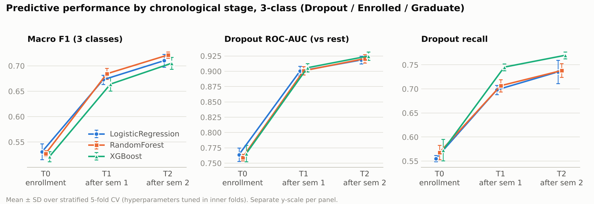
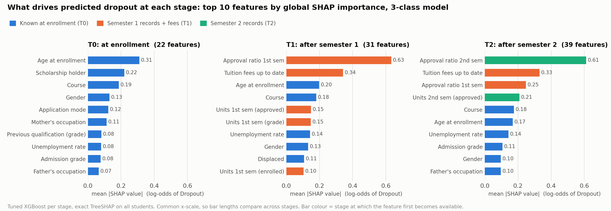
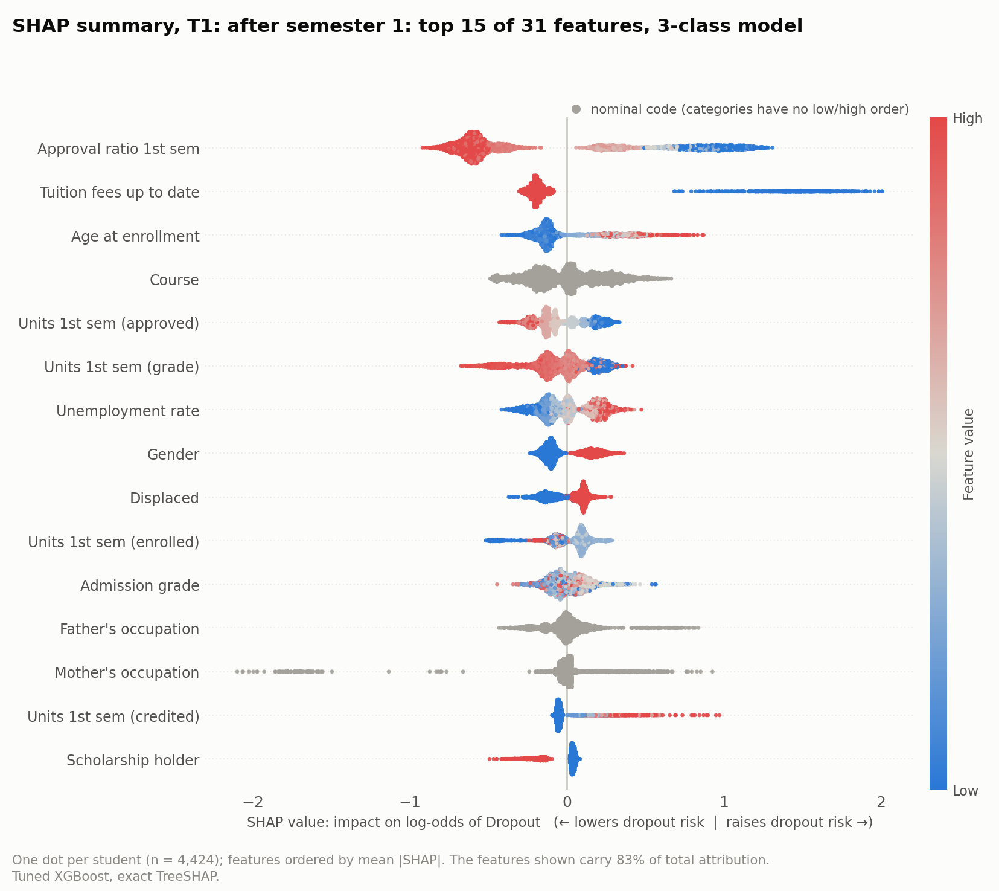
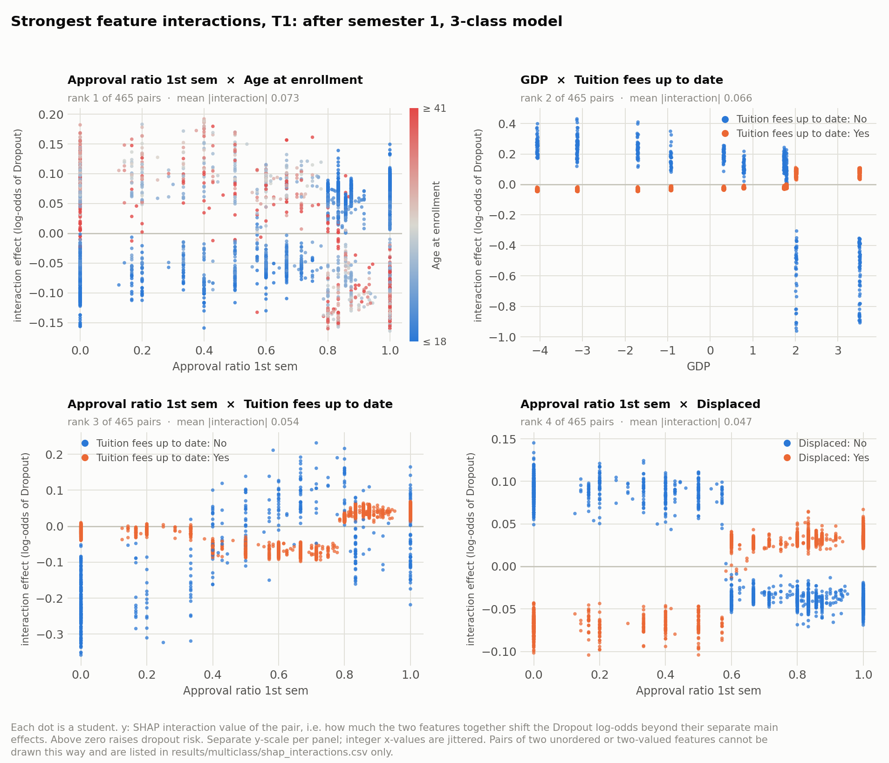
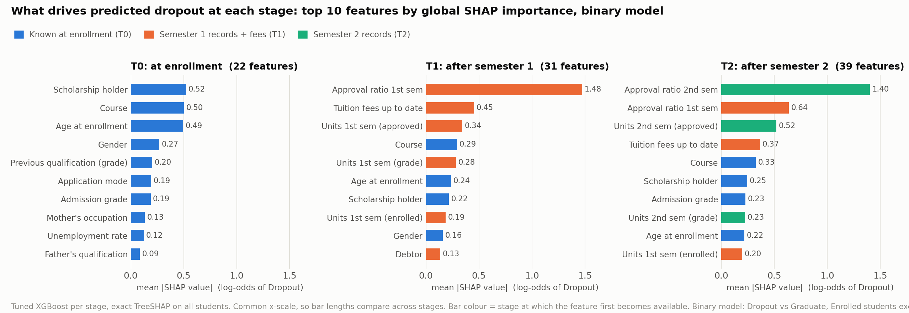
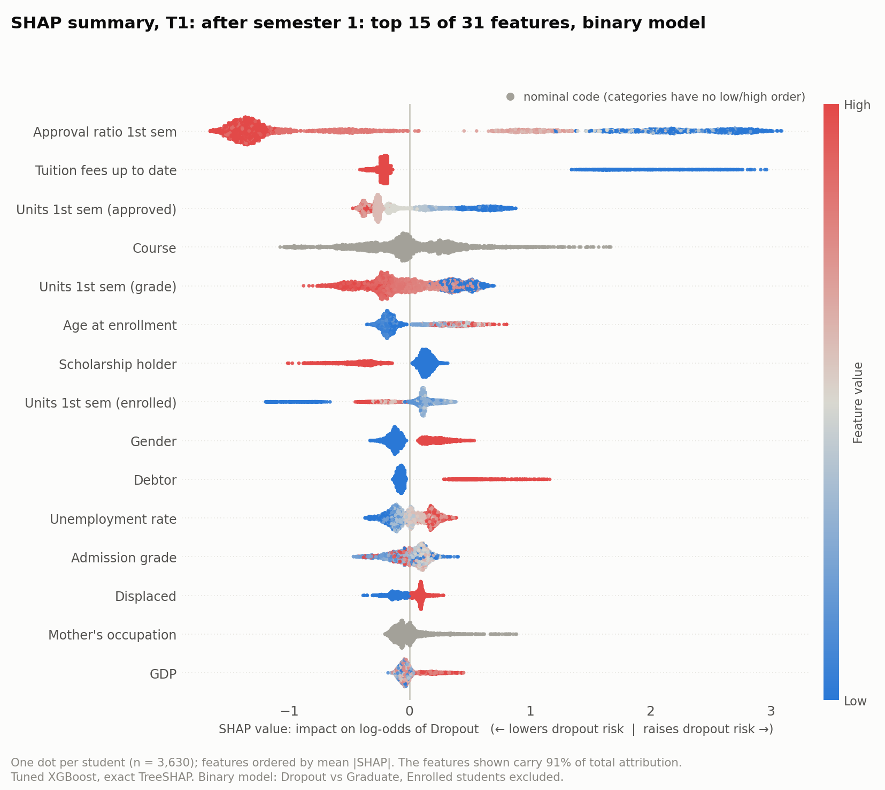
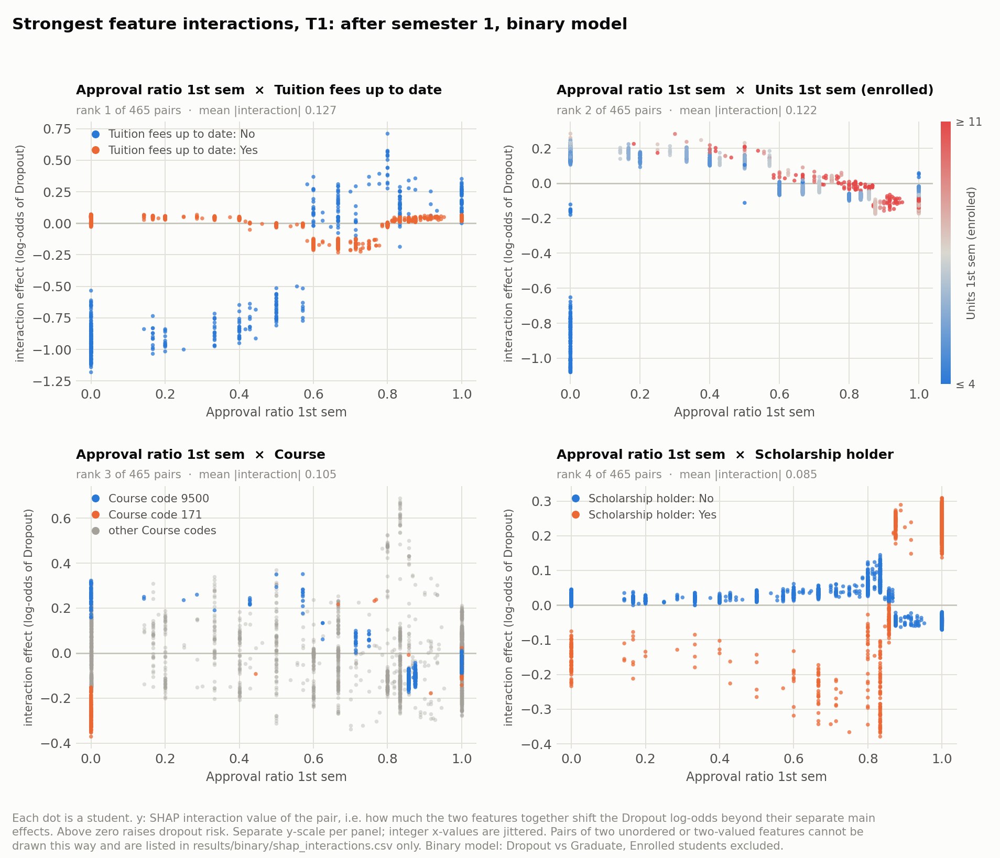

# Student Dropout Prediction: 3-stage early-warning pipeline

Capstone project on the UCI *Predict Students' Dropout and Academic Success* dataset
(4,424 students, 36 features; https://archive.ics.uci.edu/dataset/697).
Target: **Dropout / Enrolled / Graduate** (3 classes). A binary Dropout-vs-Graduate
variant runs from the same code with `--task binary`.

## Repository layout

```
data/data.csv            raw UCI file (semicolon-separated)
src/config.py            paths, seed, T0/T1/T2 feature lists, nominal columns
src/features.py          loading, domain ratios, stage-wise X/y with leakage guards
src/models.py            LR / RF / XGBoost pipelines + search spaces
src/train.py             nested stratified CV, metrics, OOF predictions, final models
src/plot_results.py      stage-comparison figure
src/explain.py           SHAP analysis: global bar and beeswarm plots, interactions
results/<task>/          cv_summary.csv, cv_fold_metrics.csv, oof_predictions.csv,
                         best_params.json, confusion_matrices.json,
                         shap_importance.csv, shap_interactions.csv
models/<task>/           final tuned models per stage 
figures/                 generated figures
notebooks/               EDA, embeddings, SHAP, fairness notebooks
```

## Quick start

```
pip install -r requirements.txt        # add --user on a managed PC, or use Colab
python -m src.train --task multiclass  # about 15 min on 2 cores
python -m src.train --task binary
python -m src.plot_results --task multiclass
python -m src.explain --task multiclass  # SHAP; about 4 min first run, then cached
python -m src.explain --task binary
```

## Chronological stages (leakage control)

| Stage | When | Raw features | Added at this stage | Engineered |
|---|---|---|---|---|
| T0 | At enrollment | 22 | demographics, socioeconomic background, macro indicators, admission data | none |
| T1 | End of semester 1 | 30 | Debtor, Tuition fees up to date, six 1st-semester curricular metrics | Approval ratio 1st sem |
| T2 | End of semester 2 | 36 | six 2nd-semester curricular metrics | Approval ratio 2nd sem, Grade change (G2 − G1) |

Stages are cumulative. `features.get_xy` asserts that no later-semester column reaches an
earlier stage. Scaling and one-hot encoding live inside the scikit-learn pipeline, so they
are fitted on the training part of each fold only.

## Evaluation protocol

- Outer loop: Stratified 5-fold CV (seed 42). The same folds are used for every stage and
  model, so comparisons are paired.
- Inner loop: 3-fold `RandomizedSearchCV`, 10 draws per model, run on the outer-training
  part only (scoring: macro F1 for 3-class, ROC-AUC for binary).
- Logistic Regression: one-hot for nominal codes (rare levels grouped), standardised numerics.
  Random Forest and XGBoost: integer codes used as-is.
- `class_weight` (none / balanced) is part of the LR and RF search; XGBoost is unweighted.
- Dropout metrics treat Dropout as the positive class against the rest.

## Results: 3-class (mean ± SD over 5 folds)

| Stage | Model | Accuracy | Macro F1 | Macro ROC-AUC (OvR) | Dropout ROC-AUC | Dropout PR-AUC | Dropout F1 | Dropout recall |
|---|---|---|---|---|---|---|---|---|
| T0 | LogisticRegression | 0.563 ± 0.014 | 0.531 ± 0.016 | 0.738 ± 0.012 | 0.764 ± 0.011 | 0.612 ± 0.014 | 0.563 ± 0.013 | 0.555 ± 0.007 |
| T0 | RandomForest | 0.570 ± 0.012 | 0.527 ± 0.006 | 0.730 ± 0.008 | 0.759 ± 0.005 | 0.602 ± 0.017 | 0.561 ± 0.008 | 0.568 ± 0.015 |
| T0 | XGBoost | 0.614 ± 0.011 | 0.521 ± 0.010 | 0.740 ± 0.011 | 0.766 ± 0.014 | 0.619 ± 0.029 | 0.576 ± 0.018 | 0.573 ± 0.022 |
| T1 | LogisticRegression | 0.714 ± 0.010 | 0.673 ± 0.009 | 0.864 ± 0.003 | 0.900 ± 0.008 | 0.853 ± 0.013 | 0.739 ± 0.014 | 0.698 ± 0.010 |
| T1 | RandomForest | 0.735 ± 0.008 | 0.684 ± 0.011 | 0.867 ± 0.005 | 0.901 ± 0.007 | 0.855 ± 0.012 | 0.753 ± 0.008 | 0.707 ± 0.013 |
| T1 | XGBoost | 0.749 ± 0.008 | 0.664 ± 0.013 | 0.874 ± 0.006 | 0.906 ± 0.007 | 0.866 ± 0.011 | 0.767 ± 0.011 | 0.745 ± 0.007 |
| T2 | LogisticRegression | 0.750 ± 0.014 | 0.710 ± 0.013 | 0.888 ± 0.006 | 0.918 ± 0.006 | 0.882 ± 0.009 | 0.777 ± 0.021 | 0.735 ± 0.024 |
| T2 | RandomForest | 0.766 ± 0.008 | 0.721 ± 0.006 | 0.890 ± 0.006 | 0.921 ± 0.007 | 0.881 ± 0.004 | 0.788 ± 0.008 | 0.738 ± 0.014 |
| T2 | XGBoost | 0.776 ± 0.008 | 0.705 ± 0.012 | 0.894 ± 0.009 | 0.925 ± 0.007 | 0.890 ± 0.004 | 0.797 ± 0.006 | 0.770 ± 0.007 |



## Results: binary Dropout vs Graduate (n = 3,630)

| Stage | Model | ROC-AUC | PR-AUC | Dropout F1 | Dropout recall |
|---|---|---|---|---|---|
| T0 | LogisticRegression | 0.804 ± 0.009 | 0.721 ± 0.011 | 0.668 ± 0.034 | 0.665 ± 0.087 |
| T0 | RandomForest | 0.793 ± 0.004 | 0.710 ± 0.021 | 0.646 ± 0.026 | 0.638 ± 0.070 |
| T0 | XGBoost | 0.808 ± 0.011 | 0.732 ± 0.016 | 0.652 ± 0.022 | 0.610 ± 0.025 |
| T1 | LogisticRegression | 0.938 ± 0.004 | 0.933 ± 0.008 | 0.851 ± 0.011 | 0.823 ± 0.024 |
| T1 | RandomForest | 0.936 ± 0.008 | 0.930 ± 0.009 | 0.845 ± 0.010 | 0.823 ± 0.016 |
| T1 | XGBoost | 0.940 ± 0.006 | 0.935 ± 0.007 | 0.854 ± 0.007 | 0.814 ± 0.014 |
| T2 | LogisticRegression | 0.954 ± 0.005 | 0.951 ± 0.006 | 0.879 ± 0.011 | 0.861 ± 0.019 |
| T2 | RandomForest | 0.955 ± 0.007 | 0.953 ± 0.005 | 0.881 ± 0.019 | 0.857 ± 0.020 |
| T2 | XGBoost | 0.958 ± 0.008 | 0.956 ± 0.006 | 0.886 ± 0.012 | 0.845 ± 0.023 |


## SHAP explainability (key predictors of dropout)

`python -m src.explain --task multiclass` explains the tuned XGBoost model of each stage.
The explained output is the model's **Dropout score on the log-odds scale**, so a positive
SHAP value pushes a student towards Dropout. Values are exact TreeSHAP from XGBoost's
built-in implementation (`pred_contribs`, `pred_interactions`); the script does not use
the `shap` package. When the values are computed, the script checks that contributions
sum to the model output for every student.

| Figure | Shows |
|---|---|
| `figures/shap_bar_<task>.png` | Top 10 features by mean \|SHAP\| at T0, T1, T2 on a common scale |
| `figures/shap_beeswarm_<task>_<stage>.png` | Per-student SHAP values, coloured by feature value |
| `figures/shap_group_share_<task>.png` | Share of attribution by the stage a feature becomes available |
| `figures/shap_interaction_heatmap_<task>_<stage>.png` | Mean \|SHAP interaction\| for the strongest pairs |
| `figures/shap_interaction_dependence_<task>_<stage>.png` | The four strongest drawable pairs, one panel each |

Full tables: `results/<task>/shap_importance.csv` (every feature and stage, mean \|SHAP\| per
class, direction) and `results/<task>/shap_interactions.csv` (every feature pair).

### Findings, 3-class model (Dropout / Enrolled / Graduate)

Numbers in brackets are mean \|SHAP\| on the Dropout log-odds. Each finding is explained
under [Reading these results](#reading-these-results), using the same numbering.

1. **At enrollment (T0) the key predictors are who the student is and what they study:**
   Age at enrollment (0.31), Scholarship holder (0.22), Course (0.19), Gender (0.13) and
   Application mode (0.12). Older students and men are pushed towards Dropout,
   scholarship holders away from it.
2. **After semester 1 (T1) academic performance takes over:** Approval ratio 1st sem
   (0.63), the share of enrolled units that were passed, is the top predictor by a wide
   margin. Units 1st sem (approved) (0.15) and Units 1st sem (grade) (0.15) follow in the
   top six.
3. **After semester 2 (T2) the most recent semester leads:** Approval ratio 2nd sem (0.61)
   ranks first; Approval ratio 1st sem drops to third (0.25).
4. **Tuition fees up to date is the strongest non-academic predictor** once it is
   available: rank 2 at both T1 (0.34) and T2 (0.33).
5. **Enrollment-time features keep a large share:** they carry 100% of attribution at T0,
   47% at T1 and 41% at T2. Age (0.20) and Course (0.18) stay in the top four at T1.
6. **Features interact:** pairwise interactions make up 49% of mean absolute attribution
   at T0, 47% at T1 and 49% at T2. The strongest pairs at T1:
   - Approval ratio 1st sem × Age at enrollment (0.073)
   - GDP × Tuition fees up to date (0.066)
   - Approval ratio 1st sem × Tuition fees up to date (0.054)







### Findings, binary model (Dropout vs Graduate, n = 3,630)

The same six findings, from the model trained without the Enrolled students.

1. **T0:** Scholarship holder (0.52), Course (0.50) and Age at enrollment (0.49) are
   nearly tied at the top, followed by Gender (0.27). Same four features as the 3-class
   model, with Scholarship holder first instead of Age.
2. **T1:** Approval ratio 1st sem (1.48) carries 31% of all attribution on its own, more
   than three times the second feature. Units 1st sem (approved) (0.34) and Units 1st sem
   (grade) (0.28) are third and fifth.
3. **T2:** Approval ratio 2nd sem (1.40) leads; Approval ratio 1st sem (0.64) and Units
   2nd sem (approved) (0.52) follow.
4. **Tuition fees up to date** is rank 2 at T1 (0.45) and rank 4 at T2 (0.37), again the
   strongest non-academic predictor.
5. **Enrollment-time features** carry 37% of attribution at T1 and 34% at T2, a smaller
   share than in the 3-class model.
6. **Interactions** make up 50% of attribution at T0, 41% at T1 and 48% at T2. The
   strongest pairs:
   - T1: Approval ratio 1st sem × Tuition fees up to date (0.127)
   - T1: Approval ratio 1st sem × Units 1st sem (enrolled) (0.122)
   - T2: Approval ratio 1st sem × Approval ratio 2nd sem (0.241), more than twice any
     other pair







### Reading these results

**How to read the numbers.** A SHAP value is the amount one feature moves one student's
Dropout score away from the average, in log-odds. +0.69 doubles the odds of Dropout and
−0.69 halves them. Mean \|SHAP\| is the average size of that move over all students, so it
measures how much the model relies on a feature, not the direction. Direction comes from
the beeswarm: dots right of zero raise dropout risk, and red dots are students with a high
value of the feature. A SHAP interaction value is the part of a prediction that two
features produce together, beyond their separate effects. The two models use different
output scales, so compare ranks and shares between them, not raw magnitudes.

**What each finding means.** The dropout rates quoted are observed rates in the data
(all 4,424 students), given to show the pattern the model picked up.

1. **Enrollment profile (T0).** With no academic record yet, the model can only use
   background. The patterns it learned are visible in the raw data: 21% of students who
   enrolled at age 20 or under dropped out against 58% of those aged 25 to 29; 12% of
   scholarship holders against 39% of the others; 45% of men against 25% of women.
   Course matters because dropout rates differ widely between programmes, from 15% to
   55% among courses with more than 100 students. Performance at this stage is modest
   (Dropout ROC-AUC 0.77), so these are weak signals that shift risk, not reliable flags
   for an individual student.
2. **Semester 1 performance (T1).** The approval ratio separates outcomes far more
   sharply than any background feature: 92% of students who passed none of their
   1st-semester units dropped out, 70% of those who passed up to half, and 11% of those
   who passed more than 80%. This is why Dropout ROC-AUC jumps from 0.77 to 0.91 at T1.
   In the beeswarm the feature splits into two clouds, low ratios (blue) far to the
   right and high ratios (red) to the left. A likely reason the ratio outranks the raw
   count of approved units is that it is comparable across courses that require
   different numbers of units.
3. **Semester 2 performance (T2).** The same pattern holds one semester later (94%
   dropout at a 2nd-semester ratio of 0, 8% above 0.8), and the model gives most weight
   to the most recent record. The two ratios largely repeat each other: in the binary
   model their interaction is positive (+0.32 on average) for students who passed over
   80% in both semesters, meaning two good semesters lower risk by less than the sum of
   their separate effects. Semester 2 mostly confirms semester 1, which matches the small
   gain in ROC-AUC from T1 to T2 (0.91 to 0.93).
4. **Tuition fees.** 87% of the 528 students who were behind on fees dropped out,
   against 25% of the rest. The beeswarm shows the asymmetry: being behind adds +0.7 to
   +2.0 to the Dropout score, while being up to date subtracts only about 0.2, because
   most students are up to date. Fee status is recorded during the year, so it may
   partly reflect a student who has already stopped attending. It is a strong warning
   sign, not evidence that fees cause dropout.
5. **Persistent share of enrollment features.** No single background feature rivals the
   approval ratios, but there are 22 of them, and their small contributions add up to
   about two fifths of the total even at T2. Background therefore still adjusts a
   student's risk after grades are known. The share is smaller in the binary model (34%
   at T2), consistent with academic records separating Dropout from Graduate more
   cleanly than they separate three classes (binary ROC-AUC 0.96 at T2). For
   the fairness analysis this means Gender and Scholarship holder keep influencing
   predictions at every stage.
6. **Interactions.** About half of the attribution depends on combinations of features,
   so no predictor should be read in isolation.
   - *Approval ratio × Age (3-class, T1):* failing units counts for more in older
     students. Among students who passed under half their units, the mean interaction
     effect is +0.10 at age 28 or over and −0.08 at age 20 or under.
   - *Approval ratio × Tuition fees (both models):* the two warning signs overlap
     instead of adding up. For students behind on fees who also passed no units the mean
     interaction effect is −0.21 in the 3-class model and −0.93 in the binary model, so
     their combined score is lower than the sum of the two separate effects. Either sign
     alone already places the student at high risk. For students behind on fees who
     passed at least 80% of their units, the interaction is positive in the binary model
     (+0.22): unpaid fees matter most for students who are otherwise doing well.
   - *Approval ratio × Units enrolled (binary, T1):* this pair exists because an approval
     ratio of 0 covers two different groups. 538 students enrolled in 1st-semester units
     and passed none (493 dropped out, 2 graduated). Another 180 students had no
     enrolled units at all (77 dropped out, 75 graduated), and `features._ratio` sets
     their ratio to 0 as well. The model uses the enrolled count to tell them apart: for
     the students with no enrolled units the interaction is −0.90, cancelling much of
     the penalty for a ratio of 0. A missing value or a "no units enrolled" flag would
     encode this directly (for Member 2's review of the domain ratios).
   - *GDP × Tuition fees (3-class):* GDP, Unemployment rate and Inflation rate take only
     10 distinct combinations in the data, one per intake cohort. This pair therefore
     says that the fee signal differs between cohorts. It should not be read as an
     effect of the economy, and the same applies to the main effects of the three macro
     variables.

**Limits that apply to every finding.**

- SHAP describes what the model uses, on the students it was trained on. It shows
  association, not cause.
- The approval ratios are computed from the approved and enrolled unit counts, so these
  features share credit. Read them as one "semester performance" family; the ranking
  inside the family is not meaningful on its own.
- Course, Application mode and the parents' occupation and qualification are unordered
  codes. They are drawn in grey in the beeswarm because low/high colouring would mislead,
  and their SHAP values say that categories differ, not which direction is "more".

## Using the outputs

- **SHAP (Member 1):** `joblib.load("models/multiclass/T1_XGBoost.joblib")` returns
  `{"model", "features", "classes"}`. `src/explain.py` re-creates the joblib from
  `best_params.json` when it is missing, computes the SHAP values with XGBoost's built-in
  TreeSHAP and caches them as `models/<task>/<stage>_XGBoost_shap.npz` (`phi`: students ×
  classes × features, `inter`: Dropout interaction values).
  `notebooks/shap_analysis.ipynb` loads these cached arrays for tables and plots.
  `shap.TreeExplainer` is not used: with the pinned versions (shap 0.49.1, xgboost 3.2.0)
  it cannot load the models, and for XGBoost it would return the same values.
- **Fairness (Member 2):** `results/<task>/oof_predictions.csv` holds out-of-fold class
  probabilities and predictions for every student, stage and model; `row` is the row index
  in `data.csv`, so join on it to get Gender and Scholarship holder.
- **Embeddings (Member 3):** colour points by `p_Dropout` from the same file.