# Student dropout prediction at three checkpoints

This capstone project predicts which students of a Portuguese higher-education institution drop out, using the UCI *Predict Students' Dropout and Academic Success* dataset (4,424 students in 17 undergraduate programmes). Every model is trained three times, each time with only the information available at that checkpoint: at enrollment (T0), after semester 1 (T1) and after semester 2 (T2). The project compares Logistic Regression, Random Forest and XGBoost at each checkpoint, explains the XGBoost models with SHAP, and checks whether prediction errors differ between student groups. A visual analytics part maps the students with PCA and UMAP and shows dropout risk across programmes, student groups and semester-to-semester patterns.

The analysis is retrospective. It describes associations in one institution's records; it does not show causes and has not been tested as a live early-warning system.

| Member | Role |
|---|---|
| Nitchayanin Thamkunanon (Member 1) | Predictive modelling and SHAP; repository and pipeline integration |
| Anapat Kitsommart (Member 2) | Data engineering, leakage control, fairness evaluation and demographic ablation |
| Mahannop Thabua (Member 3) | Dimensionality reduction and visual analytics; figure formatting |

## Research questions

From the project proposal:

- RQ1, early predictability across time: How accurately can student dropout risk be predicted at enrollment (T0) versus after the first semester (T1) and second semester (T2), under explicitly defined assumptions about which predictors are available at each checkpoint?
- RQ2, student risk patterns and model interpretation: Which academic and socioeconomic characteristics are associated with predicted dropout risk at different academic checkpoints, and where do models exhibit systematic prediction errors across student groups?

Stage-wise ("phased") dropout prediction on this dataset was published before by the dataset's authors (Martins et al., 2023), so the T0/T1/T2 design is not claimed as new. The contribution is a reproducible comparison under stated availability assumptions, with checks on feature timing, SHAP interpretation and subgroup error rates.

## Status

| Part | State | Where |
|---|---|---|
| Stage-wise models, nested cross-validation, out-of-fold predictions | Done | `src/train.py` |
| SHAP explanations (global, interactions, per-student) | Done | `src/explain.py`, `notebooks/shap_analysis.ipynb` |
| Data audit, feature-timing checks, subgroup fairness, demographic ablation | Done | `src/audit_features.py`, `src/fairness.py`, `src/ablation.py` |
| Paired stage gains and Recall@K (planned in the proposal) | Done, computed from saved predictions | `src/report_tables.py` |
| Calibration of the predicted probabilities | Done, computed from saved predictions | `src/calibration.py` |
| One-command rebuild and check of every result | Done | `run.sh`, `src/pipeline.py`, `src/verify_reproduction.py` |
| PCA/UMAP maps, map quality, clusters, risk by programme and group, semester transitions | Done | `src/visual_analytics.py`, `results/visual/`, `figures/va_*` |
| Optional tabular VAE | Considered and not built: the rule fixed in advance was not met | `results/visual/vae_decision.txt` |

## Data

`data/data.csv` is UCI dataset 697 (Realinho et al., 2022), licensed CC BY 4.0, semicolon-separated. It has 36 features and one outcome per student. The outcome is recorded at the end of the normal duration of the student's course:

| Outcome | Students | Share |
|---|---|---|
| Dropout | 1,421 | 32.1% |
| Enrolled (still studying; final outcome unknown) | 794 | 17.9% |
| Graduate | 2,209 | 49.9% |

As planned in the proposal, the primary analysis is the binary task: Dropout vs Graduate on the 3,630 students whose outcome is known. The 3-class task keeps the Enrolled students as a third class and is reported as a supplement. Every script runs either task with `--task binary` or `--task multiclass`.

## Method

### Checkpoints

| Stage | When | Raw features | Added at this stage | Engineered |
|---|---|---|---|---|
| T0 | At enrollment | 22 | Demographics, parents' education and occupation, scholarship, macro-economic indicators, admission data, programme | none |
| T1 | End of semester 1 | 30 | Debtor, Tuition fees up to date, and six semester-1 records: units credited, enrolled, evaluated, approved and without evaluation, and the grade | Approval ratio 1st sem |
| T2 | End of semester 2 | 36 | The same six records for semester 2 | Approval ratio 2nd sem, Grade change |

Stages are cumulative, so T1 and T2 models use 31 and 39 features. The engineered features are computed row by row and use no statistics from other students: *approval ratio* is approved units divided by enrolled units (set to 0 when a student enrolled in no units), and *grade change* is the semester 2 grade minus the semester 1 grade. `features.get_xy` asserts that no later-semester column reaches an earlier stage, and all scaling and encoding is fitted inside each training fold.

Two timing assumptions cannot be checked from the data. `Debtor` and `Tuition fees up to date` have no recorded observation date, so at T1 they may partly describe a student who has already stopped attending; the audit below measures how much the results depend on them. The data has no dropout dates, so the checkpoints are retrospective feature sets, not real prediction dates.

### Evaluation protocol

- Outer loop: stratified 5-fold cross-validation with seed 42. Every stage and model uses the same five folds, so differences between stages, models and ablation variants are paired.
- Inner loop: 3-fold `RandomizedSearchCV` with 10 random draws, run on the outer-training part only. It maximises ROC-AUC (binary) or macro F1 (3-class).
- Models: Logistic Regression with one-hot encoded nominal codes (levels with fewer than 10 students grouped) and standardised numeric features; Random Forest and XGBoost on the integer codes. The search includes `class_weight` (none or balanced) for LR and RF; XGBoost is unweighted.
- Decision rule: the predicted class is the most probable one (a 0.5 threshold in the binary task). Dropout metrics treat Dropout as the positive class against the rest.
- Every student gets one out-of-fold prediction per stage and model, from the fold in which they were held out (`results/<task>/oof_predictions.csv`). All fairness and ranking numbers use this file.
- The final model of each stage is refitted on all students with the same search and saved for SHAP. Its probabilities are in-sample, so they are not used for evaluation.

### Fairness and ablation

Subgroup checks compare two binary attributes: Gender (Male minus Female) and Scholarship holder (no scholarship minus scholarship). For each stage and model the scripts compute the gap in true positive rate (dropout recall; *Equal Opportunity*), in false positive rate (*Predictive Equality*) and in the share of students predicted to drop out. A gap of 0 means parity. Intervals are 95% bootstrap intervals with 1,000 resamples inside each group.

The demographic ablation retrains every model on the same folds with one of these feature sets removed:

| Variant | Features removed |
|---|---|
| `no_sensitive` | Gender, Scholarship holder |
| `no_demographic` | Gender, Age at enrollment, Marital status, Nacionality, International, Displaced, Educational special needs. Scholarship holder stays in. |
| `no_demo_socio` | Both lists above, plus the mother's and father's qualification and occupation (12 features) |

Fairness gaps are always measured against the true Gender and Scholarship labels, even when a model does not see them.

## Reproducing the results

```bash
bash run.sh
```

`run.sh` needs [uv](https://docs.astral.sh/uv/). It installs Python 3.10 and the exact package versions in `uv.lock`, moves the committed `results/`, `figures/` and `models/` to `reference/`, rebuilds every table and figure from `data/data.csv`, and compares each new file with the committed one (`reproduction_report.csv`). Because those three folders are tracked, the rebuild leaves its own files in your working tree: commit your changes before running it, and afterwards `git checkout -- results figures models` restores the committed build (`rm -rf reference` removes the moved copies). On a 20-core machine the whole pipeline takes about 17 minutes (14 for the models, 2.5 for the visual analytics); on 2 cores, training alone takes about 15 minutes per task. The two EDA figures (`figures/eda_*.png`) come from `notebooks/eda.ipynb`, not from the pipeline.

Without uv, use pip with the same pins (Python 3.10):

```bash
pip install -r requirements.txt
python -m src.pipeline                        # all steps, both tasks
python -m src.pipeline --tasks binary         # one task
python -m src.report_tables > docs/results_tables.md
```

In the table, `T` stands for `binary` or `multiclass`; each per-task step runs once for each.

| Step | Command | Reads | Writes |
|---|---|---|---|
| 1 | `python -m src.train --task T` | `data/data.csv` | `results/T/cv_summary.csv`, `cv_fold_metrics.csv`, `oof_predictions.csv`, `best_params.json`, `confusion_matrices.json`; `models/T/*.joblib` |
| 2 | `python -m src.plot_results --task T` | `cv_summary.csv` | `figures/stage_comparison_T.png` |
| 3 | `python -m src.explain --task T` | final XGBoost models | `results/T/shap_importance.csv`, `shap_interactions.csv`; `figures/shap_*`; SHAP caches in `models/T/` |
| 4 | `python -m src.audit_features --task T` | data, step 1 outputs | `results/data_audit_report.json`, `results/T/audit_*.csv`, `figures/audit_sensitivity_T.png` |
| 5 | `python -m src.fairness --task T` | `oof_predictions.csv` (binary: also the final models) | `results/T/fairness_*.csv`, `enrolled_risk_summary.csv`, `figures/fairness_*` |
| 6 | `python -m src.ablation --task T` | data, step 1 outputs | `results/T/ablation_*.csv`, `figures/ablation_tradeoff_T.png` |
| 7 | `python -m src.visual_analytics` (once, not per task) | data, binary `oof_predictions.csv` | `results/visual/*.csv`, `figures/va_*` |
| 8 | `python -m src.calibration` (once) | binary `oof_predictions.csv` | `results/calibration/*.csv`, `figures/calibration_binary.*` |
| 9 | `python -m src.report_tables` | `data/`, `results/` | the tables in `docs/results_tables.md` |

### What reproduces and what does not

Every random step is seeded (fold splits, hyperparameter draws, model seeds, bootstrap resamples), and `uv.lock` fixes every package version. Two checks were run on 21 November 2026 on a 20-core Linux ARM (aarch64) machine:

- Same machine, same environment: two complete rebuilds produced byte-identical files, namely all 39 result tables, all 34 figures and all 24 fitted-model and SHAP-cache files. The pipeline itself is deterministic.
- Against the committed results, which were built earlier on another machine: 1 of 39 result tables matched exactly. All 108 hyperparameter searches drew the same candidates, but in 45 of them, mostly Random Forest and XGBoost, a different candidate won the inner cross-validation. Candidates often score almost the same, so small floating-point differences between machines (processor, maths library, thread count) can change the winner. The machine behind the committed build is not recorded, so this is the likeliest explanation rather than a tested one. The headline cross-validated metrics moved by at most 0.005 in ROC-AUC and 0.02 in recall, F1 and macro F1. A few students' predicted probabilities moved by 0.4 or more, and the final models' SHAP values changed too.

How to read the results in this light:

- Stable across both builds: the T0 to T1 gain (+0.13 to +0.15 ROC-AUC), the near-equal performance of the three models from T1 on, the leading SHAP features at each stage (the top three or four; lower ranks change), the direction and rough size of every fairness gap, and the binary ablation findings listed under RQ2.
- Not stable: the order of near-tied features (the top three binary T0 SHAP features, the top interaction pair at T1) and paired-ablation results whose interval sits close to zero. Treat those as inconclusive.
- The numbers in this README and in `results/` are from the committed build (commit 5e560f3). On another machine, expect differences of the size described above; `reproduction_report.csv` shows exactly where your build differs.

## Results

The full set of tables, for both tasks and all three models, is in [`docs/results_tables.md`](docs/results_tables.md). It is generated by `src/report_tables.py`; edit the script, not the file.

### RQ1: how early can dropout be predicted?

Binary task (Dropout vs Graduate), mean ± SD over the 5 outer folds:

| Stage | Model | ROC-AUC | PR-AUC | Dropout F1 | Dropout recall |
|---|---|---|---|---|---|
| T0 | Logistic Regression | 0.804 ± 0.009 | 0.721 ± 0.011 | 0.668 ± 0.034 | 0.665 ± 0.087 |
| T0 | Random Forest | 0.793 ± 0.004 | 0.710 ± 0.021 | 0.646 ± 0.026 | 0.638 ± 0.070 |
| T0 | XGBoost | 0.808 ± 0.011 | 0.732 ± 0.016 | 0.652 ± 0.022 | 0.610 ± 0.025 |
| T1 | Logistic Regression | 0.938 ± 0.004 | 0.933 ± 0.008 | 0.851 ± 0.011 | 0.823 ± 0.024 |
| T1 | Random Forest | 0.936 ± 0.008 | 0.930 ± 0.009 | 0.845 ± 0.010 | 0.823 ± 0.016 |
| T1 | XGBoost | 0.940 ± 0.006 | 0.935 ± 0.007 | 0.854 ± 0.007 | 0.814 ± 0.014 |
| T2 | Logistic Regression | 0.954 ± 0.005 | 0.951 ± 0.006 | 0.879 ± 0.011 | 0.861 ± 0.019 |
| T2 | Random Forest | 0.955 ± 0.007 | 0.953 ± 0.005 | 0.881 ± 0.019 | 0.857 ± 0.020 |
| T2 | XGBoost | 0.958 ± 0.008 | 0.956 ± 0.006 | 0.886 ± 0.012 | 0.845 ± 0.023 |

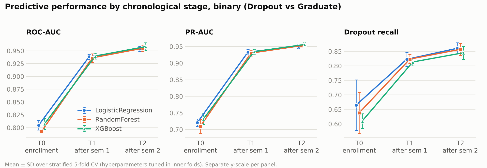

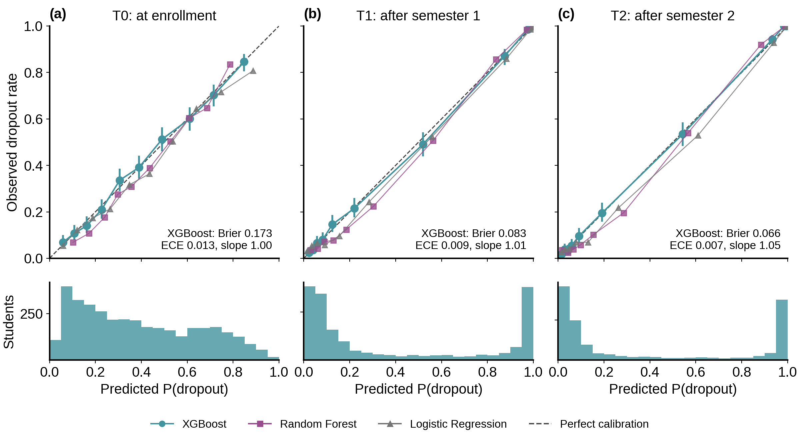

- Semester 1 records carry most of the gain. From T0 to T1, ROC-AUC rises by 0.13 to 0.14 for every model, and it rises in each of the five folds (the smallest per-fold gain is +0.116). Semester 2 adds a further 0.015 to 0.019.
- The three model families are close. At T1 and T2 their ROC-AUCs are within 0.004 of each other, about the size of the fold-to-fold SD (0.004 to 0.008).
- Suppose advisors can contact the 10% of students with the highest predicted risk. A list built at T1 contains almost only dropouts (precision 0.997 to 1.000 across models); a list built at T0 is 82% to 85% dropouts. A list that short can hold at most 26% of all dropouts, so the T1 list reaches that ceiling and the T0 list finds 21% to 22% of them.
- The XGBoost probabilities are well calibrated: expected calibration error is 0.013, 0.009 and 0.007 at T0, T1 and T2, with calibration slopes of 1.00 to 1.05 (ideal 1). Logistic Regression and Random Forest over-predict slightly (mean predicted 0.41 to 0.42 against an observed 0.39), consistent with the balanced class weights their tuning chose in 2 to 4 of the 5 folds (`src/calibration.py`, `results/calibration/`).
- With Enrolled students kept as a third class, Dropout ROC-AUC follows the same pattern: 0.76 to 0.77 at T0, 0.90 to 0.91 at T1 and 0.92 to 0.93 at T2. Macro F1 stays between 0.52 and 0.72 because the Enrolled class is hard to recognise (its F1 is 0.27 to 0.53).

### RQ2: which characteristics are associated with predicted risk?

SHAP values are computed for the final XGBoost model of each stage with XGBoost's built-in exact TreeSHAP (`pred_contribs`, `pred_interactions`), and `src/explain.py` checks that they add up to the model output for every student. They are on the log-odds scale of Dropout: a value of +0.69 doubles a student's odds of dropping out. Mean |SHAP| measures how much the model relies on a feature, not the direction of its effect; the beeswarm figures show direction.

| Stage | Top five features of the binary model, mean \|SHAP\| |
|---|---|
| T0 | Scholarship holder 0.52, Course 0.50, Age at enrollment 0.49, Gender 0.27, Previous qualification (grade) 0.20 |
| T1 | Approval ratio 1st sem 1.48, Tuition fees up to date 0.45, Units 1st sem (approved) 0.34, Course 0.29, Units 1st sem (grade) 0.28 |
| T2 | Approval ratio 2nd sem 1.40, Approval ratio 1st sem 0.64, Units 2nd sem (approved) 0.52, Tuition fees up to date 0.37, Course 0.33 |

The observed dropout rates below are for all 4,424 students and show the patterns the models pick up.

- At enrollment the model relies on who the student is and what they study. Dropout is 12.2% among scholarship holders and 38.7% among the others, 21.2% for students who enrolled aged 20 or younger and 57.6% for those aged 25 to 29, and 25.1% for women against 45.1% for men. The top three T0 features are within 0.03 of each other, so read their order as a tie.
- From T1 the semester approval ratio dominates, with about three times the weight of the next feature. Of the students who enrolled in semester-1 units and passed none, 91.6% dropped out; of those who passed more than 80%, 10.7% did.
- `Tuition fees up to date` is the strongest non-academic feature at T1 and T2. 86.6% of the 528 students behind on fees dropped out, against 24.7% of the others. Fee status is recorded during the year, so it is a warning sign, not evidence that fees cause dropout.
- Features known at enrollment still carry 37% of the total attribution at T1 and 34% at T2.
- The strongest interaction at T2 is between the two approval ratios (mean |interaction| 0.24, more than twice the next pair), which suggests the two semesters carry overlapping information.

The 3-class model ranks the same features near the top (Age at enrollment first at T0; the approval ratios and `Tuition fees up to date` at T1 and T2); see `docs/results_tables.md`.

Read these results with three cautions. SHAP describes what this model uses on these students, not what causes dropout. The approval ratios are computed from the approved and enrolled unit counts, so the ratio and the counts share credit. Course, Application mode and the parents' qualification and occupation are unordered codes, and Unemployment rate, Inflation rate and GDP take one value per intake cohort, so their SHAP values describe differences between programmes or cohorts, not effects of the economy.

### RQ2: where do prediction errors differ between groups?

Binary XGBoost, out-of-fold predictions, signed gaps with 95% bootstrap intervals:

| Stage | Gender ΔTPR (M − F) | Gender ΔFPR | Scholarship ΔTPR (none − holder) | Scholarship ΔFPR |
|---|---|---|---|---|
| T0 | +0.336 [0.288, 0.384] | +0.296 [0.249, 0.339] | +0.550 [0.486, 0.612] | +0.258 [0.234, 0.281] |
| T1 | +0.103 [0.063, 0.147] | +0.066 [0.038, 0.092] | +0.363 [0.276, 0.445] | +0.055 [0.037, 0.072] |
| T2 | +0.083 [0.047, 0.118] | +0.043 [0.020, 0.065] | +0.266 [0.180, 0.348] | +0.029 [0.013, 0.045] |

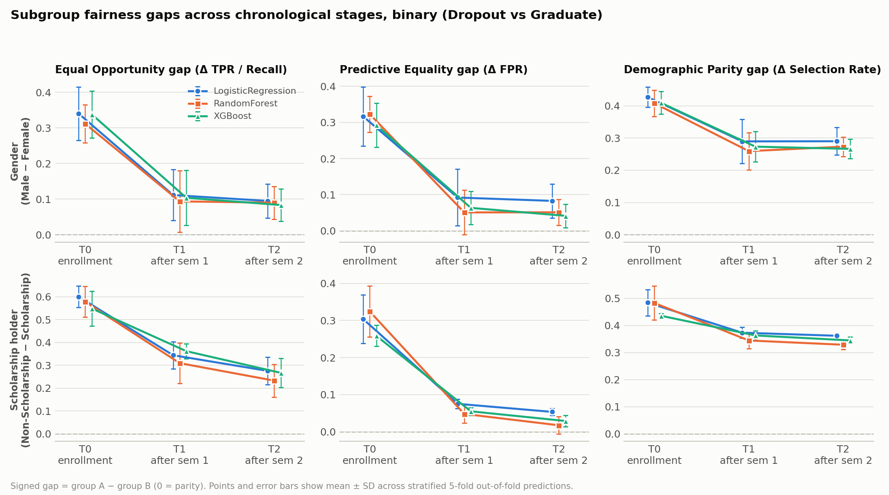

- At enrollment the model finds a much larger share of the dropouts among men and among students without a scholarship, and it also flags more of the students in those groups who go on to graduate. Group membership stands in for risk because little else is known yet.
- Academic records shrink the gaps. From T0 to T2 the gender TPR gap falls from +0.336 to +0.083 and the gender FPR gap from +0.296 to +0.043.
- The scholarship TPR gap stays large at T2 (+0.266): scholarship holders who drop out are missed more often. Their observed dropout rate is 12.2% against 38.7%, so the model starts from a much lower expectation for them.
- The difference in the share of students flagged (+0.27 for gender and +0.34 for scholarship at T2) mostly reflects the groups' different dropout rates. An accurate model is not expected to flag the groups at equal rates.

The 3-class model shows the same pattern with smaller T0 gaps (`docs/results_tables.md`).

#### Removing demographic features

Dropout ROC-AUC of binary XGBoost with each feature set:

| Stage | Full | `no_sensitive` | `no_demographic` | `no_demo_socio` |
|---|---|---|---|---|
| T0 | 0.808 | 0.780 (−0.027) | 0.798 (−0.010) | 0.762 (−0.045) |
| T1 | 0.940 | 0.936 (−0.004) | 0.937 (−0.002) | 0.934 (−0.006) |
| T2 | 0.958 | 0.955 (−0.003) | 0.957 (−0.001) | 0.957 (−0.001) |

`src/ablation.py` reports each variant's gap with its own interval, but a claim that removal improves fairness needs an interval for the change between the full model and the variant. `src/report_tables.py` adds a paired bootstrap (2,000 resamples of students, both models scored on the same resample, trained models held fixed). For binary XGBoost:

- At T0, removing Gender and Scholarship holder costs 0.027 ROC-AUC and narrows the gender TPR gap by 0.177 (95% CI 0.140 to 0.214) and the scholarship gap by 0.365 (0.283 to 0.442).
- At T1 it costs 0.004 ROC-AUC and narrows the gaps by 0.040 (0.021 to 0.060) for gender and 0.090 (0.047 to 0.140) for scholarship.
- At T2 no variant changes the gender gap measurably (`no_sensitive`: −0.001, 95% CI −0.018 to +0.016). `no_sensitive` still narrows the scholarship gap by 0.068 (0.027 to 0.116).
- `no_demographic` keeps Scholarship holder as a feature, so it never changes the scholarship gap. The three variants are therefore not nested.

These four statements also hold in the clean rebuild described under "What reproduces and what does not". The bootstrap interval treats the trained models as fixed, so it leaves out the variation that retraining brings, and results close to zero can change between builds. In the 3-class task the T2 gender gap narrows by about 0.03 in both builds, but the T1 and T2 scholarship results flip between "interval excludes 0" and "interval includes 0", so they are not reported as findings. Removing a predictive group attribute narrows error-rate gaps, but it can leave each group's risk scores less well calibrated; the Brier-score gaps are in `results/<task>/ablation_fairness_gaps.csv`. When base rates differ, a risk score cannot be calibrated within each group and also give dropouts, and graduates, the same average score in both groups, unless prediction is perfect (Kleinberg et al., 2017). Yu, Lee and Kizilcec (2021) found that adding protected attributes barely changed accuracy or fairness at a US university where those attributes explained little of dropout. In this dataset the group differences are much larger. Whether to remove the attributes is a policy choice that these numbers inform but do not settle.

### Checks on data and feature timing

- 180 students enrolled in no units in either semester, all of them in programme 171 (Animation and Multimedia Design). Their approval ratio is set to 0, the same value as the 538 students who enrolled and passed nothing, yet 42.8% of them dropped out against 91.6%. Adding 0/1 flags for them changes macro F1 by −0.006 to +0.012 and Dropout ROC-AUC by at most 0.003, so the models already tell the two groups apart, mostly through the enrolled-units count.
- Without `Debtor` and `Tuition fees up to date`, Dropout ROC-AUC drops by 0.011 to 0.024 at T1 and by 0.005 to 0.016 at T2 (all models, both tasks). Academic records alone still reach binary ROC-AUC 0.929 at T1 and 0.950 at T2 with XGBoost.
- Unemployment rate, Inflation rate and GDP take only 10 combinations, one per intake cohort.
- A semester grade of 0 means no unit was passed (718 students in semester 1, 870 in semester 2). For 236 students only one semester is 0, so their `Grade change` mixes a real grade with that 0.

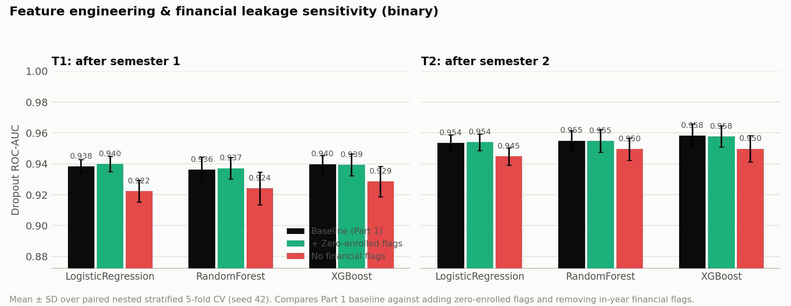

### Visual analytics: what the student maps show

`src/visual_analytics.py` maps all 4,424 students at each stage without using their outcome. The input is the stage's features, encoded as in the Logistic Regression pipeline with two changes for distances: 0/1 flags stay 0/1 (standardising a rare flag would push its few students far from everyone), and Unemployment rate, Inflation rate and GDP are left out because they only mark the intake cohort. PCA and UMAP (15, 30 and 50 neighbours, `min_dist` 0.1, seed 42) project the result to 2-D. Risk colours are the out-of-fold P(dropout) of the binary XGBoost model, so they exist only for the 3,630 students with a known outcome. All tables are in `results/visual/`, and `student_coordinates.csv` holds every student's map positions, clusters and risks for further plots.

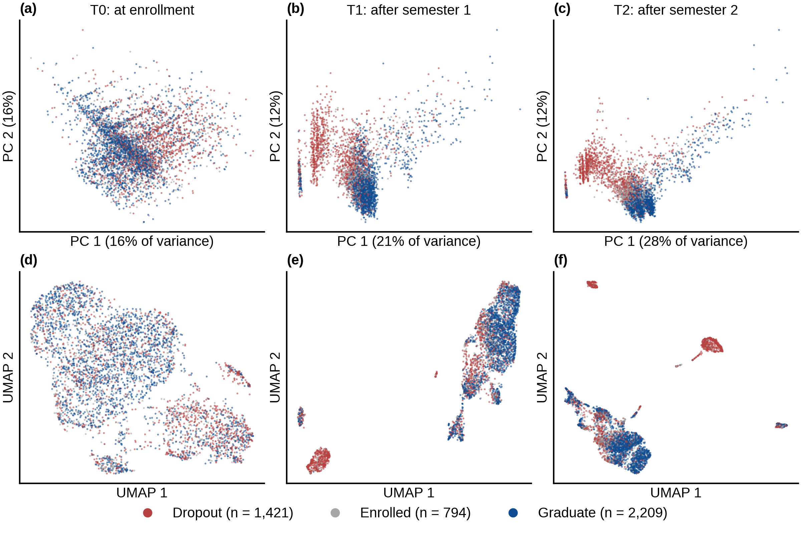

At enrollment the outcomes are mixed on both maps. From T1 most dropouts separate from graduates, and at T2 they form their own islands. The share of each student's 10 nearest map neighbours with the same outcome rises from 0.44 at T0 to 0.55 at T1 and 0.61 at T2 (UMAP, 30 neighbours; chance is 0.39; the full feature space gives 0.47, 0.60 and 0.65).

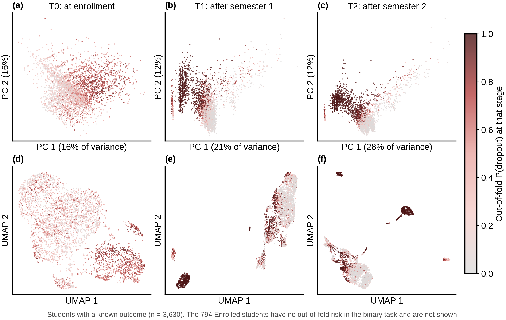

#### Map quality and the VAE decision

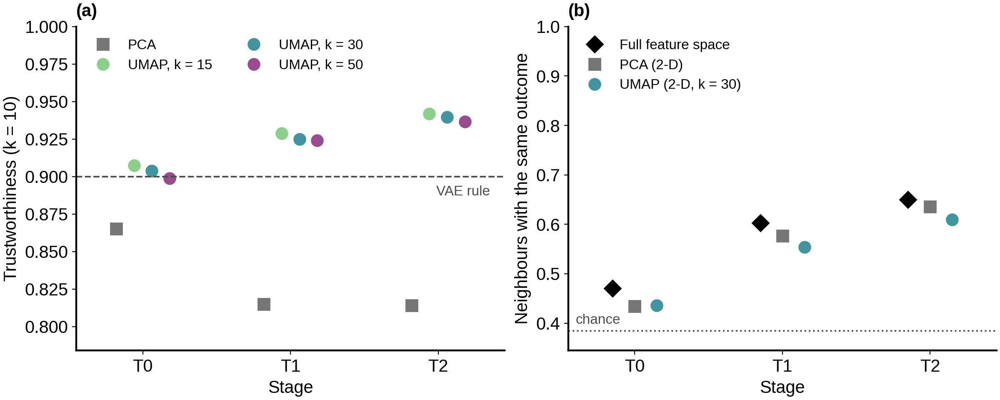

- UMAP keeps local neighbourhoods better than PCA: trustworthiness at 10 neighbours is 0.90 to 0.94 for UMAP and 0.81 to 0.87 for PCA. PCA keeps slightly more of the outcome structure (0.58 against 0.55 at T1), because its first axis follows academic performance.
- The VAE rule was fixed before running: build a tabular VAE only if every PCA and UMAP map of some stage had trustworthiness below 0.90. Each stage has a UMAP map above it (best 0.907, 0.929 and 0.942), so no VAE was built. The margin at T0 is small, and at T0 even the full feature space holds little outcome structure, so a VAE could not reveal much there either.
- Read the islands, not positions inside them. Between two UMAP seeds only a third to a half of a student's 10 nearest map neighbours stay the same (Jaccard overlap 0.20 to 0.30), while the islands persist (`figures/va_umap_sensitivity_T1.png`). Distances between islands and island sizes carry no meaning.
- Not every island is about risk. Attendance mode (daytime or evening), displacement and programme organise the maps most among the non-academic features; intake cohort barely does (neighbour agreement 0.11 to 0.17 against 0.10 by chance).

#### Clusters

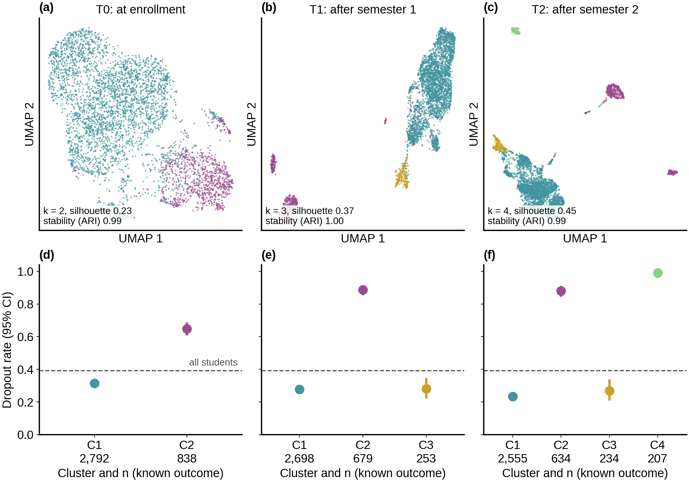

Clusters are found with k-means on the first 10 principal components (k chosen by silhouette) and drawn on the UMAP map. They are stable (adjusted Rand index 0.99 or more across seeds and 80% subsamples) but separate only weakly to moderately (silhouette 0.23, 0.37, 0.45), so they are descriptive groups, not natural types of student.

- T0, two clusters. 966 students who mostly entered through the over-23 admission route (67% against 18%), are 35 on average and study in the evening more often; 64.8% of them dropped out (95% CI 61.5% to 68.0%) against 31.4% of the rest.
- T1, three clusters. 753 students who passed almost nothing in semester 1 (mean approval ratio 0.01), of whom 88.7% dropped out; 291 students with many credited units (a third of them admitted after a change of course), whose dropout rate (28.1%) matches the main group (27.7%).
- T2, four clusters. A new group of 228 students whose semester 2 collapsed (grade change −10.2): their semester 1 was already weak (median approval ratio 0.33; 31% behind on fees against 12% overall), they still sat exams in semester 2 but passed almost nothing, and 99.0% dropped out. The T1 model had already put 87% of them in the high-risk tier.

#### Risk by programme and by student group

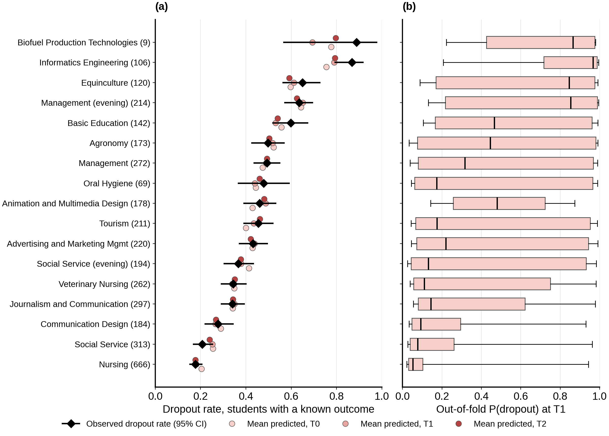

Among the 16 programmes with more than 60 students of known outcome, observed dropout runs from 17.7% (Nursing) to 86.8% (Informatics Engineering). The mean out-of-fold prediction falls inside the observed 95% interval for 16 of 17 programmes at T0 and T1 and for all 17 at T2; the exception is Informatics Engineering, which the model under-predicts (0.76 at T0, 0.79 at T1). Inside most programmes predicted risk spreads from near 0 to near 1, so the programme alone says little about an individual student. Biofuel Production Technologies has only 9 students with a known outcome.

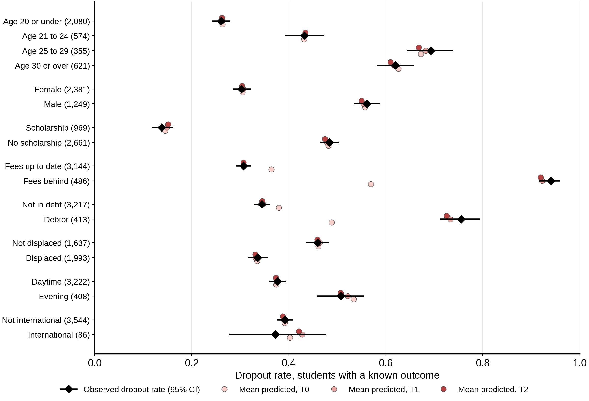

At T1 and T2 the mean prediction falls inside the observed interval for all 18 groups. At T0 it misses only the fee and debt groups, which the T0 model cannot see: students behind on fees get a mean T0 prediction of 0.57 against an observed 94.0%.

#### Semester 1 to semester 2

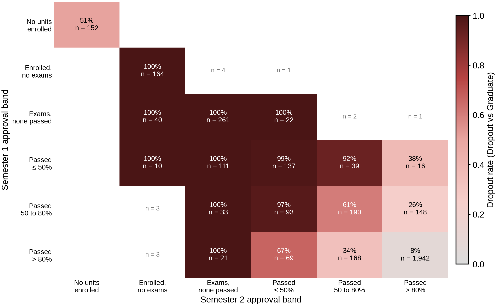

All 164 students who enrolled in units but sat no exam in both semesters dropped out, as did all 261 who sat exams and passed nothing in both semesters, and all 21 who passed more than 80% in semester 1 and then sat exams but passed nothing in semester 2. Of the 1,942 students who passed more than 80% in both semesters, 7.6% dropped out. Students who sit no exam have in effect already left, which is part of why the T1 and T2 models score so high.

#### Movement between risk tiers

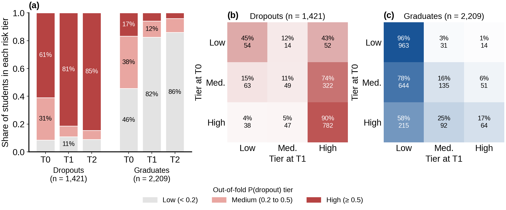

Of the eventual dropouts, 61% are already in the high tier (P(dropout) of 0.5 or more) at T0, 81% at T1 and 85% at T2. Among graduates the high tier shrinks from 17% at T0 to 6% at T1. Of the 120 dropouts in the low tier at T0, 52 move to the high tier at T1; of the 371 graduates flagged high at T0, 215 move to the low tier at T1. The tier cut-offs (0.2 and 0.5) were fixed before plotting; 0.5 is the decision threshold the models use.

## Limitations

- All data come from one institution, and dropout rates differ widely between its programmes (15.4% to 55.3% among programmes with more than 100 students), so the models may not transfer elsewhere.
- The checkpoints are retrospective feature sets. The data has no dropout dates, and the fee flags may have been recorded after a student stopped attending.
- Part of the T1 and T2 performance is detection of students who had already stopped attending: all 169 students who enrolled in semester-1 units but sat no exam dropped out. Without the 538 students who passed nothing in semester 1, binary XGBoost still reaches ROC-AUC 0.909 at T1 against 0.788 at T0 (pooled out-of-fold predictions; `docs/results_tables.md`), so the stage gain is real but smaller than the headline numbers.
- The binary task leaves out the 794 Enrolled students, whose outcome is unknown. The 3-class task treats them as a class, although many of them will later graduate or drop out.
- The random 5-fold splits put students from every intake cohort in both training and test folds. Holding out whole cohorts would be closer to predicting a new intake.
- The hyperparameter search is small (10 random draws per fold). XGBoost is trained without class weights while LR and RF may use them, so recall is not compared like for like across models.
- The student maps and clusters describe this cohort's records. UMAP distances and island sizes have no meaning, positions inside islands change with the seed, and clusters are partitions of a weakly clustered space.
- Fairness gaps depend on the decision rule (the most probable class) and on which error rate is chosen. With 2 attributes, 3 metrics, 3 stages, 3 models and 2 tasks, some differences will appear by chance.

## Repository layout

```
data/data.csv              UCI dataset 697 (semicolon-separated)
src/config.py              paths, seed, stage feature lists, nominal columns
src/features.py            loading, engineered ratios, stage-wise X/y with leakage assertions
src/models.py              LR / RF / XGBoost pipelines and search spaces
src/train.py               nested cross-validation, metrics, out-of-fold predictions, final models
src/plot_results.py        stage comparison figure
src/explain.py             SHAP values (XGBoost TreeSHAP), importance, interactions, figures
src/audit_features.py      data audit, zero-enrolment flags, removal of financial flags
src/fairness.py            subgroup and intersectional error rates, Enrolled risk summary
src/ablation.py            demographic ablation (paired with the main run)
src/visual_analytics.py    Part 3: PCA/UMAP maps, map quality, clusters, risk by programme and group
src/calibration.py         calibration of the out-of-fold probabilities (Brier, ECE, slope)
src/report_tables.py       README and docs tables, paired stage gains, Recall@K
src/pipeline.py            runs every step in order; --fresh --verify rebuilds and checks
src/verify_reproduction.py compares regenerated outputs with a reference copy
src/figstyle.py            figure style helpers (figures4papers house style)
results/<task>/            tables written by the scripts
results/visual/            Part 3 tables, the VAE decision and every student's map coordinates
figures/                   figures written by the scripts
models/<task>/             fitted final models and SHAP caches (rebuilt by train/explain)
notebooks/                 EDA, SHAP and fairness notebooks that read the saved outputs
docs/results_tables.md     generated result tables
run.sh, pyproject.toml, uv.lock, requirements.txt   environment and one-command rebuild
```

## References

- Realinho, V., Machado, J., Baptista, L., & Martins, M. V. (2022). Predicting Student Dropout and Academic Success. *Data*, 7(11), 146. https://doi.org/10.3390/data7110146
- Martins, M. V., Tolledo, D., Machado, J., Baptista, L. M. T., & Realinho, V. (2021). Early Prediction of Student's Performance in Higher Education: A Case Study. In *Trends and Applications in Information Systems and Technologies* (WorldCIST'21), 166-175. https://doi.org/10.1007/978-3-030-72657-7_16
- Martins, M. V., Baptista, L., Machado, J., & Realinho, V. (2023). Multi-Class Phased Prediction of Academic Performance and Dropout in Higher Education. *Applied Sciences*, 13(8), 4702. https://doi.org/10.3390/app13084702
- Kaufman, S., Rosset, S., Perlich, C., & Stitelman, O. (2012). Leakage in Data Mining: Formulation, Detection, and Avoidance. *ACM TKDD*, 6(4), 1-21. https://doi.org/10.1145/2382577.2382579
- Lundberg, S. M., & Lee, S.-I. (2017). A Unified Approach to Interpreting Model Predictions. *NeurIPS 30*. https://arxiv.org/abs/1705.07874
- Lundberg, S. M., Erion, G. G., & Lee, S.-I. (2018). Consistent Individualized Feature Attribution for Tree Ensembles. https://arxiv.org/abs/1802.03888
- Kizilcec, R. F., & Lee, H. (2022). Algorithmic Fairness in Education. In *The Ethics of Artificial Intelligence in Education*, 174-202. Routledge. https://doi.org/10.4324/9780429329067-10
- Kleinberg, J., Mullainathan, S., & Raghavan, M. (2017). Inherent Trade-Offs in the Fair Determination of Risk Scores. *ITCS 2017*. https://doi.org/10.4230/LIPIcs.ITCS.2017.43
- Yu, R., Lee, H., & Kizilcec, R. F. (2021). Should College Dropout Prediction Models Include Protected Attributes? *Proceedings of L@S '21*. https://doi.org/10.1145/3430895.3460139
- McInnes, L., Healy, J., & Melville, J. (2018). UMAP: Uniform Manifold Approximation and Projection for Dimension Reduction. https://arxiv.org/abs/1802.03426
- Jeon, H., Park, J., Shin, S., & Seo, J. (2025). Stop Misusing t-SNE and UMAP for Visual Analytics. https://arxiv.org/abs/2506.08725
- Kingma, D. P., & Welling, M. (2014). Auto-Encoding Variational Bayes. *ICLR*. https://arxiv.org/abs/1312.6114
